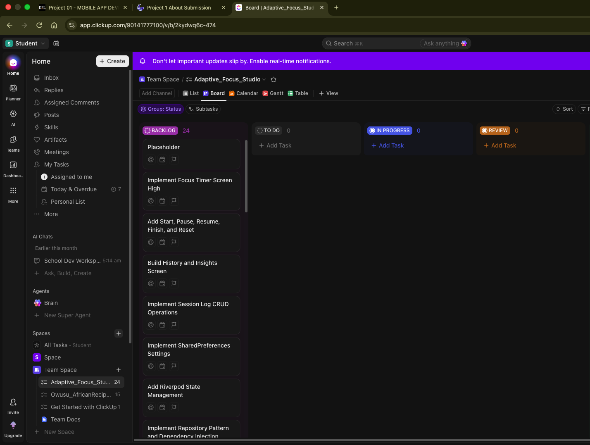
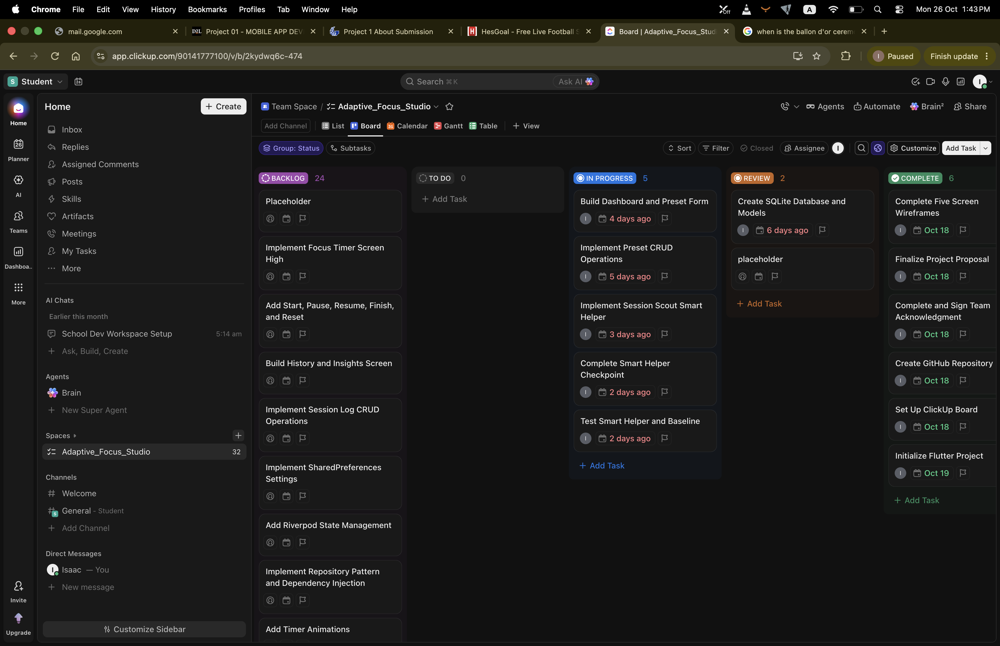
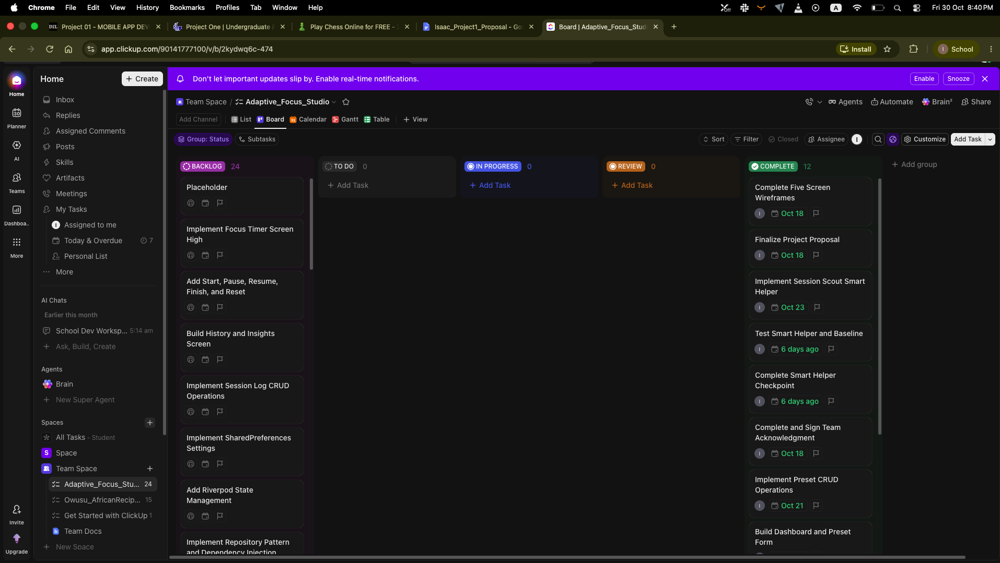

# Adaptive Focus Studio — Development Journal

**Project:** Adaptive Focus Studio  
**Course:** CSC 6360 — Mobile App Development  
**Developer:** Isaac Owusu  
**Project Type:** Individual Final Project  
**Framework:** Flutter and Dart

## 1. Introduction

Adaptive Focus Studio is a mobile application I developed to help students organize their study sessions and track their progress. The application allows users to create focus presets, run study timers, record study sessions, and view their study history.

I worked on this project independently, which meant I was responsible for planning, coding, testing, and documentation. My goal was to build something useful while applying the concepts I learned in mobile app development.

This journal explains how I organized my work, the main features I implemented, and some of the challenges and decisions I made during development.

## 2. Project Planning and Task Management

I used ClickUp to organize my development tasks. Since I was working alone, I needed a simple way to keep track of the features I wanted to implement and the work I had already completed.

I organized the project using a Kanban board with four main categories:

- **Backlog:** Features and improvements I planned to work on later.
- **To Do:** Tasks I was ready to start.
- **In Progress:** Tasks I was currently working on.
- **Done:** Tasks I had completed.

I broke the project into smaller tasks instead of trying to implement everything at once. This made it easier to focus on one feature at a time and track my progress.

### 2.1 ClickUp Kanban Evidence

The following screenshots show how I organized and tracked the development of Adaptive Focus Studio using ClickUp.

#### ClickUp Board Overview

*Figure 1: My ClickUp Kanban board showing the different project tasks and their statuses.*

#### Development Progress

*Figure 2: A screenshot showing how I tracked tasks during development.*

#### Completed Tasks

*Figure 3: Tasks marked as completed on my ClickUp board.*

Using ClickUp helped me stay organized throughout the project. It was particularly useful for keeping track of the different features, testing tasks, and documentation I needed to complete.

## 3. Development Approach

I developed the application in stages, starting with the basic project structure before moving on to individual features.

I used Flutter for the interface and Dart for the application logic. I organized the code into presentation, domain, and data layers to keep different responsibilities separate.

For state management, I used Riverpod. I chose SQLite to store focus presets and session logs because I wanted the application to work without an internet connection. I used SharedPreferences for simpler settings, such as the default focus duration and notification preferences.

I also used Git throughout development to track changes. Instead of implementing everything in one large update, I worked on smaller parts of the application and committed changes as I progressed.

## 4. Main Development Stages

### 4.1 Project Setup and Architecture

I started by setting up the Flutter project and organizing the folder structure.

I separated the code into different layers so that the UI would not directly handle database operations. This helped me keep the project organized as I added more features.

I also set up the repositories, use cases, and providers needed to connect the different parts of the application.

### 4.2 Focus Preset Management

I implemented the ability to create, edit, view, and delete focus presets.

Each preset contains a name, mood tag, and duration. I added form validation to prevent users from saving empty names or invalid durations.

I used SQLite to store the presets locally so that they would still be available after the application was closed.

### 4.3 Focus Timer

The focus timer was one of the main features I worked on.

I implemented controls for starting, pausing, resuming, finishing, and resetting a study session.

I used a Stopwatch to track elapsed time instead of relying only on periodic timer callbacks. This helped me calculate the actual time spent studying more accurately.

I also added checks to prevent a session from being saved more than once.

### 4.4 Session History and Statistics

After implementing the timer, I worked on recording study sessions and displaying them in the history screen.

The history screen allows users to review their previous sessions, add manual logs, edit existing records, and delete sessions.

I also added summary statistics, including:

- Completed sessions
- Partial sessions
- Total study time
- Average session duration
- Longest session
- Completion rate

These statistics give users a quick overview of their study activity.

### 4.5 Session Scout

I implemented Session Scout as a local recommendation feature.

The purpose of Session Scout is to suggest a focus duration based on previous study sessions. The recommendation uses a deterministic, median-based calculation rather than connecting to an external AI service.

I wanted the feature to be understandable and useful even when the application is offline.

I also included baseline comparisons to help evaluate the recommendation approach.

### 4.6 Settings and Data Backup

I added a settings screen where users can change their default focus duration, notification preference, sound preference, and reduced-motion setting.

I used SharedPreferences to store these settings locally.

I also implemented JSON backup and restore functionality. Users can export their focus presets and study history or import a previously saved backup.

Because importing a backup replaces the current data, I added a confirmation message before the restore operation.

### 4.7 UI Improvements

After implementing the main features, I worked on improving the application's appearance and usability.

I updated the welcome screen, dashboard, preset form, focus timer, history screen, and settings screen.

I focused on keeping the interface simple and consistent. I also added loading indicators, error messages, and confirmation dialogs where needed.

I included reduced-motion support to make the application more accessible to users who prefer fewer animations.

## 5. Technical Challenges and Decisions

### 5.1 Timer Accuracy

One important decision was how to track time accurately.

Initially, I considered how periodic timer callbacks could be affected by delays. I used Stopwatch to track elapsed time and calculate the remaining duration.

This approach also made it easier to handle pausing and resuming a session.

### 5.2 Preventing Duplicate Session Records

Another area that needed attention was saving completed sessions.

I added checks to prevent the same session from being recorded multiple times, especially when a user finishes a session or interacts with the timer controls.

### 5.3 Managing Asynchronous Operations

Several parts of the application use asynchronous operations, including database access, loading settings, and saving records.

I used `mounted` checks before updating the UI after asynchronous operations. I also added loading states and error messages so users receive feedback when something goes wrong.

### 5.4 Local Data Storage

I wanted Adaptive Focus Studio to work offline, so I used SQLite for the main application data.

I kept SharedPreferences for smaller settings because those values do not need the same database structure as presets and session logs.

Separating these responsibilities made the storage approach easier to manage.

### 5.5 Backup and Restore

The backup feature required extra care because importing a backup replaces existing records.

I added a confirmation dialog before importing and handled invalid backup files with error messages.

I also refresh the relevant Riverpod providers after a successful restore so the updated data appears in the application.

## 6. Testing and Validation

I used automated tests during development to check the application's behavior.

The testing work covered areas such as preset management, session records, providers, and application logic.

I also used widget and integration tests to check how different parts of the application behave through the interface.

I used Flutter's testing and analysis tools to identify problems and check that the code was working as expected.

The detailed test cases, results, and supporting evidence are documented separately in [Testing Documentation](testing.md).

## 7. Version Control

I used Git to track the project as I worked on different features.

My approach was to implement a manageable part of the application, check that it worked, and then commit the changes.

This helped me keep a record of the development process instead of waiting until the entire application was finished before committing.

The Git commit history provides additional evidence of how the application developed over time.

## 8. What I Learned

Working on Adaptive Focus Studio helped me understand how the different parts of a Flutter application work together.

I gained more experience with state management, local databases, asynchronous programming, form validation, and automated testing.

One of the biggest things I learned was the importance of organizing a project before adding too many features. Separating responsibilities across different layers made it easier to work on individual features without constantly changing unrelated code.

I also learned that testing and error handling are important parts of development, not just things to add at the end.

Since I worked on the project alone, I also had to manage my time and decide which features to prioritize. Using ClickUp and Git helped me stay organized and keep track of my progress.

## 9. Conclusion

Adaptive Focus Studio gave me an opportunity to build a complete Flutter application independently.

The project combines several concepts from the course, including local persistence, state management, navigation, asynchronous programming, and testing.

Using ClickUp and Git helped me organize the work and track my progress. Overall, the project improved my understanding of mobile application development and gave me practical experience managing a larger application from planning through implementation.
