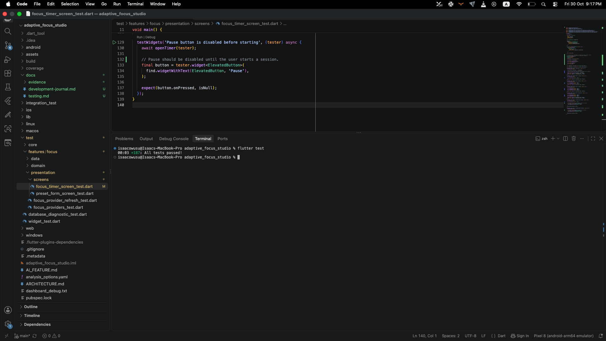
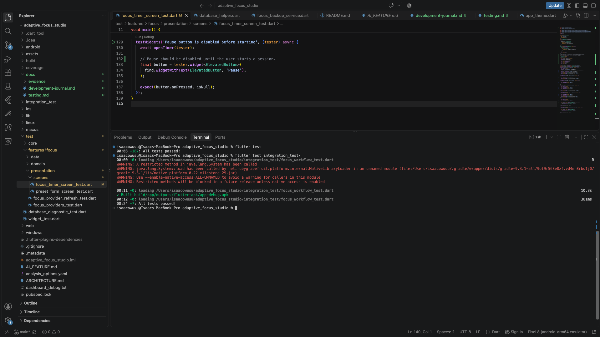
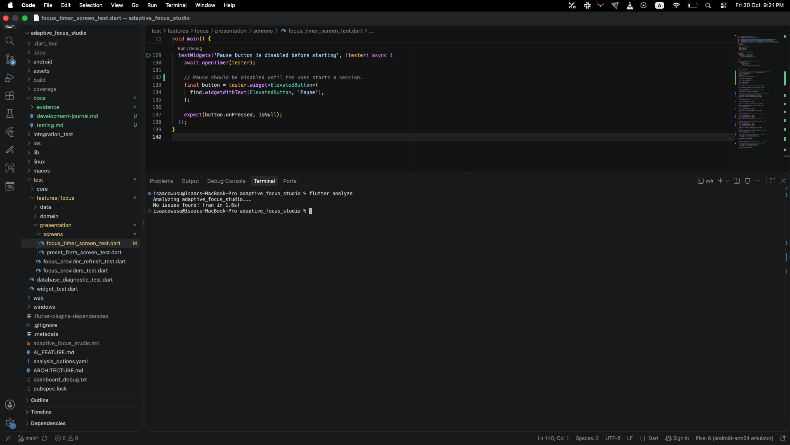

# Adaptive Focus Studio — Testing Documentation

**Project:** Adaptive Focus Studio  
**Course:** CSC 6360 — Mobile App Development  
**Developer:** Isaac Owusu  
**Project Type:** Individual Final Project  
**Framework:** Flutter and Dart

## 1. Introduction

Testing was an important part of developing Adaptive Focus Studio. Since the application handles study timers, focus presets, session history, and user settings, I wanted to make sure the different features worked correctly and that the data was stored and retrieved properly.

I used automated tests throughout development to check individual functions, application state, and user interactions. I also tested the application manually on the Android emulator to see how the features behaved when used together.

After completing the implementation, I ran the automated tests again. All tests passed in the final run.

This document explains my testing approach, the tools I used, the areas I tested, and the final results.

## 2. Testing Tools

I used the following tools and packages during development:

| Tool | Purpose |
|------|---------|
| flutter_test | Running unit and widget tests |
| integration_test | Testing application workflows |
| sqflite_common_ffi | Testing SQLite database operations |
| Riverpod ProviderContainer | Testing providers and application state |
| flutter analyze | Checking code for analyzer issues |
| flutter test --coverage | Generating test coverage data |

These tools helped me check the application without having to manually repeat every test after making changes.

## 3. Unit Testing

I used unit tests to check individual parts of the application separately from the user interface.

This made it easier to identify problems because I could test the application logic directly.

### 3.1 Focus Preset Tests

I tested the logic responsible for managing focus presets.

The areas covered included:

- Creating a focus preset
- Retrieving saved presets
- Updating an existing preset
- Deleting a preset
- Handling invalid input
- Checking that saved data is returned correctly

These tests helped me verify that the preset management logic worked as expected.

### 3.2 Session Management Tests

I also tested the logic responsible for managing study session records.

The areas covered included:

- Saving a study session
- Retrieving session history
- Updating session records
- Deleting session records
- Calculating session statistics
- Handling empty session history

These tests were important because session records are used for study statistics and Session Scout recommendations.

### 3.3 Database Tests

I used `sqflite_common_ffi` to test SQLite database operations without depending on a physical Android device.

I used an in-memory database for the tests so that test records would not affect the application's actual stored data.

This allowed me to test database operations in a controlled environment.

### 3.4 Riverpod Provider Tests

I tested Riverpod providers using `ProviderContainer`.

These tests helped me check how application state changes when data is created, updated, deleted, or loaded.

I also used provider overrides where necessary to isolate dependencies and make the tests easier to manage.

## 4. Session Scout Testing

Session Scout is the recommendation feature in Adaptive Focus Studio.

It suggests a focus duration using previous study sessions and a deterministic, median-based approach.

I included tests for the recommendation logic because I wanted the output to be predictable and understandable.

The important cases included:

- No previous study sessions
- A small number of completed sessions
- Multiple sessions with different durations
- Sessions with unusually long or short durations
- Consistent recommendations for the same input data

I also considered how the recommendation compares with a simpler baseline, such as using a fixed default duration.

The recommendation approach and its evaluation are explained in [AI Feature Documentation](../AI_FEATURE.md).

## 5. Widget Testing

I used widget tests to check how different parts of the application behave when users interact with them.

Unlike unit tests, widget tests allow me to check Flutter widgets and how they respond to actions.

The areas covered included:

- Displaying application screens
- Checking form fields and validation messages
- Responding to button presses
- Displaying loading indicators
- Showing error messages
- Updating the interface after state changes

Widget testing was useful because it helped me identify issues that might not be visible when testing application logic alone.

## 6. Integration Testing

I used integration tests to check how different parts of the application work together.

These tests were important because a feature might work correctly on its own but behave differently when used through the application.

The main workflows included:

- Opening the application
- Creating a focus preset
- Viewing saved presets
- Editing a preset
- Starting and finishing a focus session
- Viewing session history
- Updating application settings

Integration testing helped me check the overall behavior of the application rather than only individual functions.

## 7. Test Execution

I used the terminal to run the automated tests.

### 7.1 Unit and Widget Tests

```bash
flutter test
```

This command runs the tests inside the `test/` directory.

### 7.2 Integration Tests

```bash
flutter test integration_test/
```

This command runs the integration tests.

I used the Android emulator to test the application in a device environment.

### 7.3 Static Analysis

```bash
flutter analyze
```

I used Flutter's analyzer during development to identify code issues.

### 7.4 Test Coverage

```bash
flutter test --coverage
```

This command generates the coverage report at:

```text
coverage/lcov.info
```

The report can be used to review which parts of the application were exercised by the automated tests.

## 8. Final Test Results

After completing the application, I ran the automated tests again to make sure the final changes had not introduced new problems.

All automated tests passed.

| Test Category | Final Result | Status |
|---------------|--------------|--------|
| Unit and widget tests | 187 passed | PASS |
| Integration tests | 7 passed | PASS |
| **Total** | **194 passed** | **PASS** |

The final test run confirmed that the automated tests completed successfully.

### 8.1 Final Verification Summary

| Verification | Result |
|--------------|--------|
| Unit tests | Passed |
| Widget tests | Passed |
| Integration tests | Passed |
| Overall automated testing | Passed |
| Static analysis | Used during development |
| Coverage report | Available through Flutter coverage command |
| Manual application testing | Performed during development |

The automated tests all passed. Static analysis and coverage are documented separately because they are not included in the automated test count.

## 9. Testing Evidence

I kept screenshots of the testing process to support the final results.

### 9.1 Unit and Widget Test Results



*Figure 1: Terminal output showing the unit and widget test results.*

### 9.2 Integration Test Results



*Figure 2: Terminal output showing the integration test results.*

### 9.3 Static Analysis Results



*Figure 3: Flutter static analysis output.*

These screenshots provide supporting evidence of the testing and code verification process.

## 10. Manual Testing

In addition to automated testing, I manually checked the application using the Android emulator.

I tested the main features by interacting with the application the same way a user would.

Some of the checks I performed included:

- Creating a new focus preset
- Editing and deleting saved presets
- Starting, pausing, and finishing focus sessions
- Viewing saved session history
- Adding and editing manual session records
- Checking study statistics
- Changing application settings
- Checking form validation and error messages
- Navigating between the main screens

Manual testing helped me check the overall experience, especially navigation and visual details that are not always obvious from automated test results.

## 11. Challenges During Testing

One challenge was testing database-related code without depending on the device's actual database.

I addressed this by using `sqflite_common_ffi` and an in-memory database for tests.

Another challenge was testing Riverpod providers that depend on repositories and other services. I used `ProviderContainer` and provider overrides to make those tests easier to manage.

I also had to pay attention to asynchronous operations because some features load or save data in the background.

These situations helped me understand why separating application logic from the user interface is important.

## 12. What I Learned

Testing Adaptive Focus Studio helped me better understand how to verify the behavior of a Flutter application.

I learned how to test individual functions, work with an in-memory SQLite database, and use Riverpod provider overrides during testing.

I also learned that automated tests are especially useful when making changes to an existing feature. Instead of checking everything manually after every update, I could run the tests to see whether the changes affected other parts of the application.

Working on the tests also helped me identify areas where the code could be organized more clearly.

## 13. Conclusion

Testing was an important part of completing Adaptive Focus Studio.

I used unit tests, widget tests, integration tests, and manual testing to check the application's functionality.

After the final implementation changes, I ran the automated tests again, and all 194 previously recorded tests passed.

The testing process helped me improve the reliability of the application and gave me more confidence that its main features were working as expected.

It also gave me practical experience writing and running automated tests for a Flutter application.
